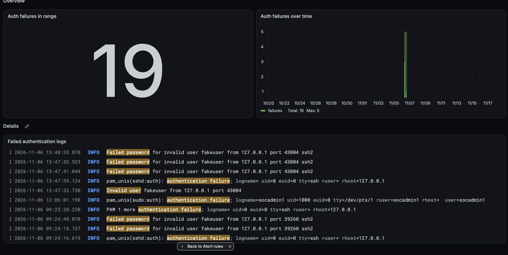
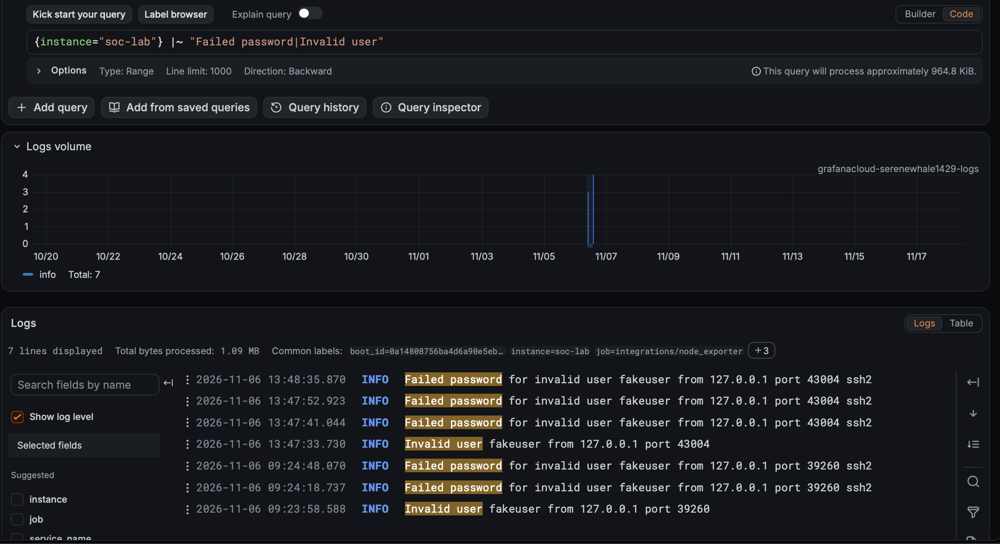
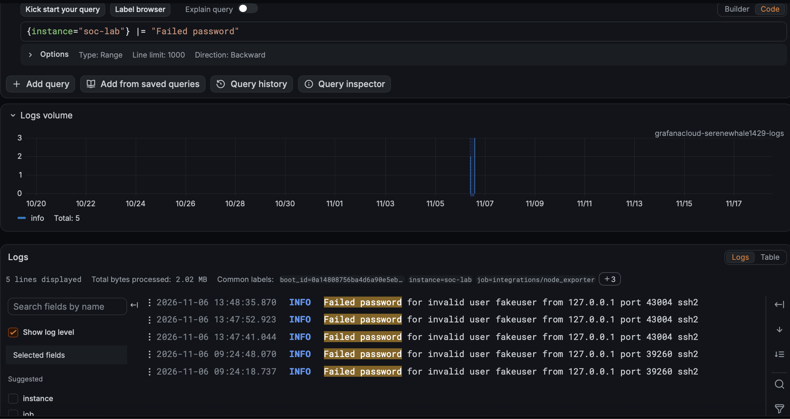
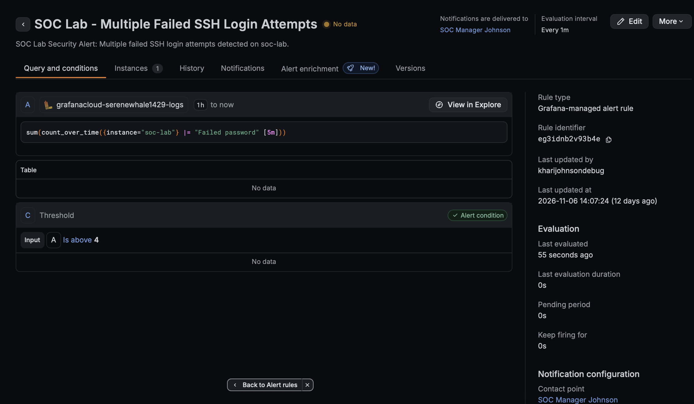
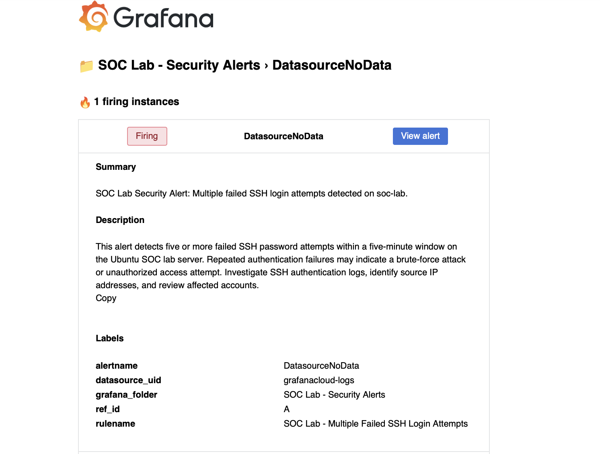

SOC SSH Threat Detection Lab

Built a SOC threat detection lab using Ubuntu Server, Grafana Cloud, Loki, and Grafana Alloy to monitor SSH authentication logs, identify repeated failed login attempts, and generate automated security alerts with email notifications.

Project Overview

This project involved developing a virtualized Security Operations Center (SOC) monitoring environment to collect, analyze, and detect suspicious SSH authentication activity on an Ubuntu Linux server.

The primary objective was to establish a centralized logging and detection workflow capable of identifying potential credential-guessing activity and notifying security personnel when predefined detection thresholds were exceeded.

After deploying an Ubuntu Server virtual machine, I configured Grafana Alloy to collect and forward system authentication logs to Grafana Cloud. Using LogQL, I developed detection logic to identify repeated failed SSH login attempts within a five-minute observation window.

To validate the detection workflow, I generated controlled unsuccessful SSH authentication attempts within the local lab environment. These events were recorded, ingested into Loki, and identified through Grafana queries.

I subsequently configured a Grafana-managed alert rule to detect elevated failed-login activity and deliver automated email notifications when the configured threshold was exceeded.

Technologies Used

Ubuntu Server 24.04 LTS: Linux environment and authentication log source

UTM: Virtual machine deployment and management

Grafana Cloud: Centralized security monitoring and alerting

Grafana Alloy: Log collection and forwarding

Grafana Loki: Log aggregation and querying

LogQL: Security event analysis and detection logic

OpenSSH: Authentication service used for simulated security events

Lab Architecture

Ubuntu Server → Grafana Alloy → Grafana Loki → Grafana Cloud Alerting → Email Notification

The Ubuntu server generates authentication events, Grafana Alloy forwards the logs to Loki, and Grafana Cloud provides the querying and alerting capabilities needed to identify suspicious activity.

Detection Use Case

Threat: Repeated failed SSH authentication attempts potentially indicating credential-guessing activity.

Detection objective: Identify five or more failed SSH password events within a five-minute window.

LogQL Detection Query:

sum(count_over_time({instance="soc-lab"} |= "Failed password" [5m]))

Alert Configuration:

Detection window: 5 minutes

Alert threshold: Greater than 4 failed-password events

Evaluation interval: 1 minute

Notification method: Email

Testing and Validation

Log Collection: Established centralized collection of Ubuntu authentication events using Grafana Alloy and Loki.

Threat Detection: Identified simulated failed SSH authentication attempts using custom LogQL queries.

Detection Engineering: Implemented a five-minute observation window with a threshold of more than four failed-password events.

Alert Validation: Confirmed that the detection rule identified simulated authentication failures and generated email notifications.

Security Analysis: Demonstrated how repeated authentication failures can serve as an indicator of potential credential-guessing activity requiring further investigation.

Security Detection Evidence

The following screenshots document the implementation, testing, and validation of the SSH threat detection workflow.

1. SOC Security Monitoring Dashboard

The Grafana dashboard provides centralized visibility into SSH authentication activity, including a summary of authentication failures, a time series visualization, and detailed security logs.

2. Failed SSH Authentication Logs
   

Grafana Loki successfully collected authentication events generated during controlled SSH login attempts. The logs contain failed-password messages, invalid user activity, and associated timestamps.

3. LogQL Security Investigation

Using LogQL, I filtered authentication logs to identify failed SSH password attempts and examine the associated security events.

4. Automated SSH Detection Alert

Configured a Grafana-managed alert rule to detect five or more failed SSH password events within a five-minute observation window, with evaluations performed every minute.

5. Automated Security Email Notification

Successfully validated the alerting workflow by generating controlled authentication failures that triggered a Grafana security notification with a Firing status.

This confirmed that the detection rule and email notification process operated as intended during testing.

Security Significance

Repeated failed SSH authentication attempts may indicate password guessing, brute-force activity, or unauthorized access attempts.

This detection workflow provides visibility into suspicious authentication behavior and supports initial SOC alert triage.

An alert does not independently confirm malicious activity. Additional investigation would be necessary to determine the source, context, and potential impact of the authentication failures.

Future Improvements

Correlate failed authentication events with successful SSH logins.

Investigate source IP addresses associated with suspicious activity.

Incorporate network traffic analysis using Wireshark.

Integrate Suricata for network intrusion detection.

Develop documented incident response and alert triage procedures.

Refine detection thresholds to reduce false positives.

Final Assessment

Successfully implemented and validated a centralized SSH authentication monitoring and alerting workflow using Ubuntu Linux and Grafana Cloud.

The project demonstrated foundational SOC capabilities, including security telemetry collection, log analysis, detection rule development, controlled attack simulation, and automated security notifications.

All authentication failures were intentionally generated within an authorized lab environment and do not represent a confirmed external intrusion.

Overall Outcome: Established a functioning security monitoring and detection workflow that provides a foundation for further SOC investigations, detection tuning, and incident response exercises.

Disclaimer

All authentication testing was performed within an authorized, isolated lab environment for educational and defensive security purposes.
